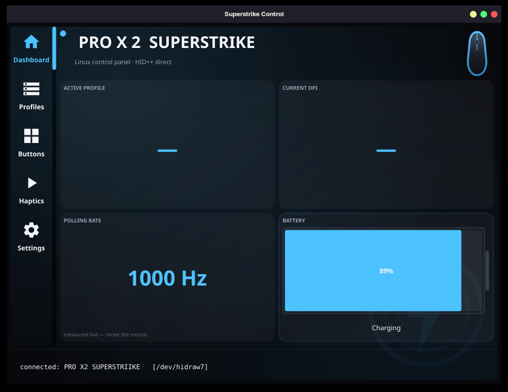
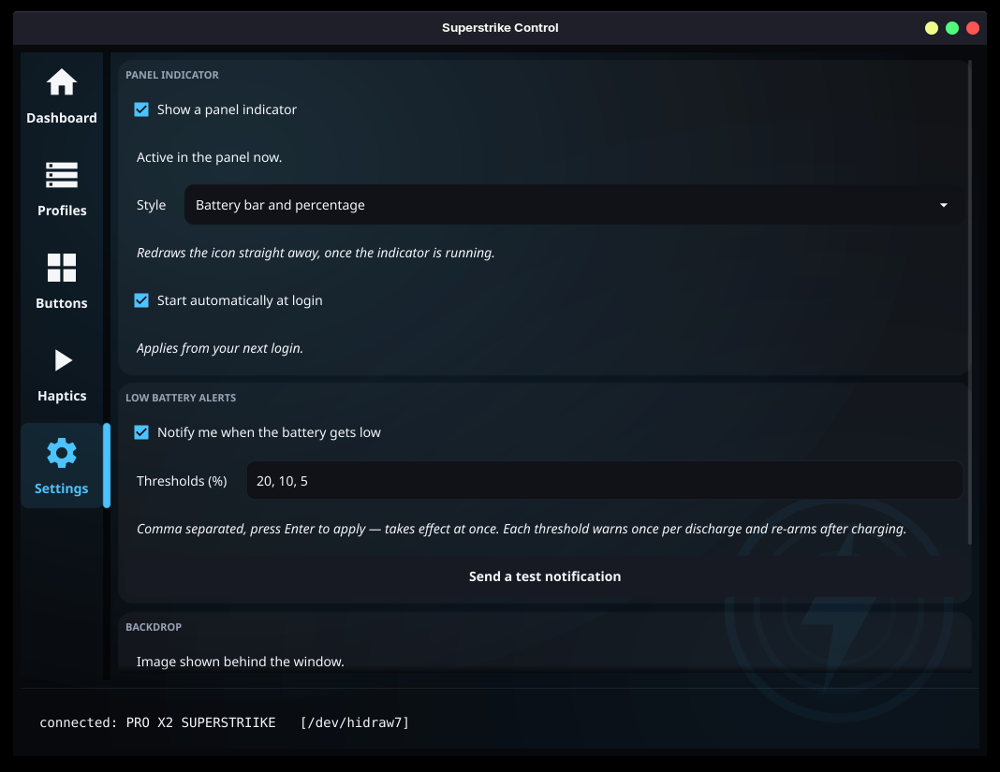
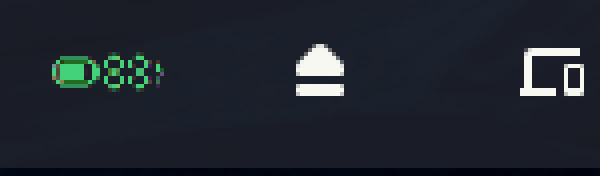
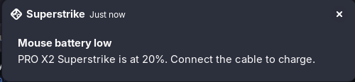

# Linux Superstrike

**A native Linux control app for the Logitech PRO X 2 Superstrike** — the G HUB
features that mouse needs (DPI, polling rate, haptics, button remapping,
profiles), on Linux, in a single self-contained binary. No daemon, no Wine, no
cloud account.


> 🤖 **Fully vibe-coded** — this entire app (protocol reverse-engineering and
> all) was built collaboratively with an AI coding assistant. See
> [`REVERSE_ENGINEERING.md`](REVERSE_ENGINEERING.md) for how the mouse's HID++
> protocol and onboard-profile format were figured out.

## Why this exists

The PRO X 2 Superstrike has no Logitech software on Linux, and existing tools
(Solaar, libratbag) don't yet cover its newer features — especially its
**haptic switches** and its quirky onboard-profile layout. This app talks the
**HID++ 2.0** protocol directly over `/dev/hidraw` and configures the mouse the
same way G HUB does under the hood: by editing its **onboard profiles**, so
your settings apply instantly **and persist on the mouse itself**.

## Features

- **Dashboard** — live device info, active profile, current DPI, **real polling
  rate measured from your actual mouse movement**, and an animated battery gauge.
- **Profiles** — full management of all 5 onboard profiles: per-profile **DPI
  (X/Y)**, **polling rate** (125–8000 Hz), enable/disable, set-active, and rename.
- **Buttons** — remap any button to another **mouse button**, a **keyboard key**
  (with Ctrl/Shift/Alt/Super), a **media key**, a built-in **function**
  (DPI/profile cycle, etc.), or disable it.
- **Haptics** — tune the analog buttons' **click haptics**, **actuation point**,
  and **rapid trigger** (feature `0x1B0C`).
- **Panel indicator** — optional tray icon showing the battery level at a
  glance, with a menu for the exact reading. Styles: battery bar and
  percentage, bar only, or percentage only.
- **Low battery alerts** — desktop notifications at configurable thresholds
  (20 / 10 / 5 % by default), each firing once per discharge cycle.
- **Settings** — indicator style, alert thresholds, autostart at login.
- Clean, themed UI; everything writes to onboard memory and **survives reboots**.

## Screenshots

| | |
| --- | --- |
|  |  |
| Dashboard | Settings |

Panel indicator, sitting alongside the usual system icons:



Low battery alert:



## Panel indicator & battery alerts

Both are optional and configured in the **Settings** tab.

The indicator registers as a **StatusNotifierItem**, the same mechanism every
other tray application uses, so it is not tied to a distribution. What it needs
is a host for that protocol:

| Desktop | Works out of the box? |
| --- | --- |
| KDE Plasma | Yes — native StatusNotifierItem host |
| Ubuntu (GNOME) | Yes — ships `gnome-shell-extension-appindicator` enabled |
| Zorin OS | Yes — ships its own AppIndicator extension enabled |
| Cinnamon, MATE, LXQt | Yes |
| Debian (GNOME) | Install `gnome-shell-extension-appindicator`, then enable it |
| Fedora (GNOME) | Install `gnome-shell-extension-appindicator` |
| Xfce | Install `xfce4-statusnotifier-plugin` |

Without a host the app still runs and the alerts still fire; only the panel icon
is missing, and the Settings tab says so instead of failing silently.

Notifications go through `org.freedesktop.Notifications`, which every desktop
implements, so those are portable everywhere.

The indicator icon is rendered as a wide PNG rather than an SVG on purpose:
Fyne rasterises SVG tray icons into a fixed square, which would letterbox a wide
icon and make it *smaller* in the panel.

Alerts go out over `org.freedesktop.Notifications` so they can carry the
`urgency` hint — readings at or below 10 % are marked critical and stay on
screen until dismissed. Each threshold fires once and only re-arms after the
level climbs a few points clear of it, so a reading hovering on the boundary
does not warn on every poll. Charging resets all thresholds.

```sh
superstrike -tray          # start as an indicator only, no window
superstrike -testnotify    # post one sample notification per threshold
```

To have the indicator start with your session, enable *Start automatically at
login* in Settings — it manages an XDG autostart entry for you.

### Backdrop

The window backdrop ships with a neutral built-in mark. Drop your own image at
`~/.config/superstrike/logo.svg` (`.png` / `.jpg` also work) to replace it; no
rebuild needed, just restart. No vendor logo is bundled — this project is not
affiliated with Logitech.

## Install

### Option A — download the release (recommended)

1. Grab the latest `superstrike` binary from the
   [**Releases**](../../releases) page and make it executable:
   ```sh
   chmod +x superstrike
   ```
2. **Grant access to the mouse** (one-time udev rule, so it runs without sudo):
   ```sh
   sudo tee /etc/udev/rules.d/70-logitech-superstrike.rules >/dev/null <<'EOF'
   KERNEL=="hidraw*", SUBSYSTEM=="hidraw", ATTRS{idVendor}=="046d", MODE="0660", TAG+="uaccess"
   SUBSYSTEM=="usb", ATTRS{idVendor}=="046d", MODE="0660", TAG+="uaccess"
   EOF
   sudo udevadm control --reload-rules && sudo udevadm trigger
   ```
   Then replug the mouse (or reboot).

   > ⚠️ **The filename number matters.** The rule must be numbered **below 73**
   > (we use `70-`). systemd's `73-seat-late.rules` is what turns the `uaccess`
   > tag into a per-user ACL, and udev applies rules in lexical order — a `99-`
   > rule sets the tag *too late*, so the device stays root-only. The usual
   > symptom is "it worked, then after a reboot the app says no mouse / permission
   > denied." If you installed an older `99-…` rule, delete it:
   > `sudo rm /etc/udev/rules.d/99-logitech-superstrike.rules`
3. Run it:
   ```sh
   ./superstrike
   ```

> The binary is dynamically linked against the standard desktop OpenGL/X11
> libraries (a GUI-toolkit requirement) — present on essentially every Linux
> desktop. If something's missing it'll tell you.

### Option B — build from source

Requires Go 1.23+ and the usual GL/X11 dev headers (for the GUI).

```sh
git clone https://github.com/mclol0/linux-superstrike
cd linux-superstrike
go build -o superstrike .
```

To install it as a desktop app (icon + launcher in your menu):

```sh
./packaging/install.sh
```

## How it works

This mouse ignores the standard *live* DPI/rate setters in firmware — the only
thing that actually takes effect (and what G HUB does) is editing the **onboard
profile** stored on the mouse. So the app:

- speaks HID++ 2.0 directly over `/dev/hidraw` (no `hidapi`/CGO HID dependency);
- reads/writes the profile sectors (DPI, report rate, buttons, RGB), recomputing
  the CRC and verifying the write;
- measures the **true** polling rate by counting HID input reports, because the
  device's rate register reports a stale value.

For the full protocol details — feature table, DPI/rate encodings, the onboard
profile sector layout, haptics, and button format — see
[**`REVERSE_ENGINEERING.md`**](REVERSE_ENGINEERING.md).

## Headless / debugging

The binary doubles as a CLI for diagnostics:

```
superstrike -probe        # device info + full HID++ feature table
superstrike -profiles     # list all profiles + control sectors
superstrike -measurerate  # measure the real report rate (move the mouse)
superstrike -scan         # list Logitech hidraw nodes + HID++ responses
superstrike -tray         # start as a panel indicator only, without a window
superstrike -testnotify   # post one sample low-battery notification per threshold
```

## Status & compatibility

- Verified on the **PRO X 2 Superstrike** over the LIGHTSPEED receiver.
- Detection is connection-agnostic (any USB port, the dongle, reconnects). Wired
  and Bluetooth modes should work too; if a mode isn't detected, run
  `superstrike -scan` in that mode and open an issue with the output.

## Credits & disclaimer

Protocol details were informed by the excellent
[Solaar](https://github.com/pwr-Solaar/Solaar) and
[libratbag](https://github.com/libratbag/libratbag) projects.

This is an **unofficial** community tool, **not affiliated with or endorsed by
Logitech**. It writes to your mouse's onboard memory; it's careful (CRC-verified
writes, read-back), but use it at your own risk.

## License

[MIT](LICENSE)
